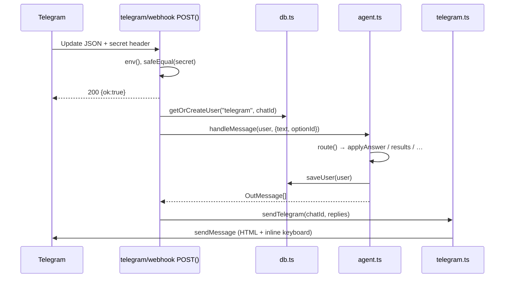

# Scheme Saathi: codebase and features

This document explains what the app does, how the code is organised, and what each file is responsible for. Section 10 traces each request from input to output function by function, and section 11 lists every function with its inputs, output and purpose. For diagrams of the runtime flows see [FLOW.md](FLOW.md); for why things are built this way see [DECISIONS.md](DECISIONS.md).

---

## 1. What the product does

Scheme Saathi is a chat assistant for Indian citizens. A user messages the bot on **WhatsApp** or **Telegram**, answers about ten short questions, and gets a list of government schemes they may be eligible for, with the benefits, documents to keep ready and the official link to apply. It works in **English, Hindi and Malayalam**.

A daily **pipeline** reads official government portals, finds new schemes and application windows (open and close dates), and sends alerts to eligible users when applications open and three days before they close.

A **website** explains the product, has an in-browser demo of the bot, and includes an admin dashboard.

## 2. Feature list

### Bot (WhatsApp, Telegram, web demo)

| Feature | Where |
| --- | --- |
| Language choice (English / हिन्दी / മലയാളം), switchable any time with `language` | `src/lib/agent.ts`, `src/lib/i18n.ts` |
| Profile questions: age, gender, state, rural/urban, occupation, land (farmers only), income band, category, disability, BPL card, daughter under 10 | `src/lib/agent.ts` (`ORDER`, `QUESTION`, `CHOICES`) |
| Answers by button tap, number, label in any language, yes/no words in all three languages, or free text interpreted by Groq | `resolveChoice()` in `agent.ts`, `interpretChoice()` in `llm.ts` |
| State recognition from English, Hindi and Malayalam names and aliases | `STATES` + `matchState()` in `i18n.ts` |
| Ranked results: open windows first, then by how specifically a scheme targets the user | `matchSchemes()` in `eligibility.ts` |
| Scheme details: summary, benefits, documents, how to apply, window dates, official link | `schemeDetails()` in `agent.ts` |
| Free-form questions answered by Groq, grounded only in the user's matched schemes | `answerQuestion()` in `llm.ts` |
| Commands: `menu`, `schemes`, `restart`, `language`, `alerts on`, `alerts off`, `help` | `COMMANDS` in `agent.ts` |
| Privacy guard: Aadhaar, PAN, card and passport numbers are detected, refused and never stored | `containsSensitiveData()` in `agent.ts` |
| Consent notice before any question (DPDP Act 2023); declining stores nothing; existing users are asked once | `consentPrompt()` and the consent branch in `route()`; `users.consent_at` |
| `/delete` with confirmation erases profile, settings and alert history | `deleteUser()` in `db.ts`, `delete:*` options in `route()` |

### Scheme catalogue

* 25 seed schemes (central plus Kerala), each with name, summary, benefits and how-to-apply in all three languages, documents, official URL and machine-readable eligibility rules: `src/lib/schemes/seed.ts`.
* Rules support min/max age, genders, occupations, categories, max income, states, area, disability, BPL, land, girl child and `anyOf` (for example "SC/ST **or** woman" for Stand-Up India).

### Discovery and alert pipeline

* Fetches six official sources (NSP, PM Internship, myScheme, PIB RSS, Kerala DCE scholarships, kerala.gov.in), configurable via `data/sources.json`.
* Skips pages whose content hash is unchanged.
* With Groq: extracts schemes, windows, eligibility rules and en/hi/ml translations as validated JSON.
* Without Groq: heuristic finds "last date … <date>" next to known scheme names.
* Puts new schemes and window changes in a **review queue**; nothing reaches users until an admin approves it. Approval publishes the item and alerts eligible users once per window ("opened" and "closing soon").
* Runs in the background behind a lock (one run at a time) and reports items to review or failed sources to the admin on Telegram.
* Runs from Vercel Cron, `npm run pipeline`, or the admin dashboard button.

### Admin tools

| Page | What it does | Code |
| --- | --- | --- |
| `/admin` | Review queue, stats, pipeline runs | `app/admin/page.tsx` |
| `/admin/schemes`, `/admin/schemes/[id]` | Edit a scheme in en/hi/ml with validated rules; hide/show | `app/admin/schemes/*`, `lib/scheme-edit.ts` |
| `/admin/broadcast` | Message consented, subscribed users by channel/language; history with delivery counts | `app/admin/broadcast/page.tsx`, `lib/broadcast.ts` |
| `/admin/insights` | Drop off funnel and breakdowns | `app/admin/insights/page.tsx`, `lib/insights.ts` |
| `/admin/export/*.csv` | `users` (pseudonymised), `schemes`, `translations`, `fact-check` | `app/admin/export/[file]/route.ts`, `lib/csv.ts` |

Server actions for all admin forms live in `app/admin/actions.ts`; the tab bar is `app/admin/AdminChrome.tsx`; sign-in checks are in `lib/admin-auth.ts`.

### Monitoring

`lib/monitoring.ts` sends errors to a Sentry-compatible endpoint (`SENTRY_DSN`) and a throttled Telegram alert to the admin. `log.error()` calls it automatically, and `onRequestError` in `instrumentation.ts` catches unhandled errors in routes, pages and server actions.

### Website

| Route | Purpose |
| --- | --- |
| `/` | Marketing homepage: hero with animated chat demo, problem, tagline reveal, benefits, how it works, scheme explorer with filters, privacy, FAQ, final CTA |
| `/try` | Full bot simulator using the real agent and database |
| `/admin` | Login with `ADMIN_TOKEN`, then the review queue (approve / reject), stats, live pipeline logs, "Run now", scheme table with window and review status |
| `/privacy`, `/terms` | Draft legal pages |
| 404 | Branded not-found page |

### HTTP API

| Endpoint | Method | Purpose |
| --- | --- | --- |
| `/api/telegram/webhook` | POST | Telegram updates (messages and button callbacks) |
| `/api/whatsapp/webhook` | GET | Meta webhook verification handshake |
| `/api/whatsapp/webhook` | POST | WhatsApp Cloud API messages (text, buttons, lists, template replies) |
| `/api/chat` | POST | Web simulator: `{ sessionId, text, optionId? }` → `{ replies }` |
| `/api/health` | GET | Health probe: status, environment, channels, last pipeline run |
| `/api/pipeline/run` | GET/POST | Starts a run in the background and replies `202 {runId, statusUrl}`; `409` if one is already running; `?force=1` re-reads unchanged pages; `?wait=1` blocks until done. Requires `Authorization: Bearer $CRON_SECRET` in production |
| `/api/pipeline/status` | GET | Status and live log of a run (`?id=<runId>`, or the latest), plus how many items wait for review. Same auth |

---

## 3. Tech stack

| Layer | Choice |
| --- | --- |
| Framework | Next.js 16 (App Router), React 19, TypeScript |
| Storage | Node's built-in `node:sqlite` (`DatabaseSync`), file at `data/scheme-saathi.db` |
| AI (optional) | OpenAI TypeScript SDK via Groq, model `openai/gpt-oss-120b`, structured outputs via Zod |
| Messaging | Telegram Bot API, Meta WhatsApp Cloud API (plain `fetch`) |
| UI | Plain CSS with design tokens, Manrope + Noto Sans Devanagari/Malayalam via `next/font`, Phosphor icons |
| Tests | `node:test` run through `tsx` |
| Scheduling | `vercel.json` cron, or any OS scheduler calling `npm run pipeline` |

---

## 4. Directory layout

```
scheme-saathi/
├── data/                     SQLite database (git-ignored); optional sources.json
├── docs/                     CODEBASE.md, FLOW.md, DECISIONS.md
├── scripts/
│   ├── pipeline.ts           CLI: run discovery + alerts (--force, --no-notify)
│   ├── seed.ts               CLI: reload the built-in catalogue
│   └── set-telegram-webhook.ts
├── src/
│   ├── app/                  Next.js routes (pages + API)
│   │   ├── layout.tsx        Fonts, metadata, skip link
│   │   ├── globals.css       Design tokens, buttons, nav, footer, reveal, prose
│   │   ├── page.tsx          Homepage (server component)
│   │   ├── home.css          Homepage + phone mock-up styles
│   │   ├── try/              Simulator page + WhatsApp-style chat CSS
│   │   ├── admin/            Dashboard page + CSS
│   │   ├── privacy/, terms/  Legal drafts
│   │   ├── not-found.tsx, icon.svg
│   │   └── api/              chat, health, telegram/webhook, whatsapp/webhook, pipeline/run, pipeline/status
│   ├── instrumentation.ts, startup.ts   Config check at server start
│   ├── components/           Client UI pieces (nav, chat demo, simulator, reveals…)
│   └── lib/                  All business logic (framework-independent)
│       ├── env.ts            Validated config + APP_ENV rules
│       ├── log.ts            JSON (prod) / readable (dev) logger
│       ├── security.ts       Constant time compare, client IP, rate limiter
│       ├── types.ts          Shared types
│       ├── db.ts             Persistence
│       ├── agent.ts          Conversation engine
│       ├── eligibility.ts    Rule matching + window status
│       ├── i18n.ts           All bot strings, option sets, state names
│       ├── llm.ts            Groq helpers
│       ├── links.ts          Public CTA links from env
│       ├── channels/         telegram.ts, whatsapp.ts, index.ts (proactive sends)
│       ├── pipeline/         sources.ts, run.ts, notify.ts
│       └── schemes/seed.ts   Built-in scheme catalogue
├── tests/bot.test.ts
├── .env.development.example, .env.production.example
├── Dockerfile, .dockerignore, vercel.json, next.config.ts, tsconfig.json, package.json
└── README.md
```

---

## 5. Core modules in detail

### `src/lib/env.ts`, `log.ts`, `security.ts`
* `env()` parses every variable once with Zod (empty values count as unset), works out which channels are enabled, and in production **throws** if required settings are missing. `configReport()` lists errors and warnings; `src/startup.ts` prints them at boot and exits in production.
* `log` writes JSON lines in production and readable output in development, filtered by `LOG_LEVEL`.
* `safeEqual()` compares secrets in constant time; `rateLimiter()` is an in memory fixed window limiter used by `/api/chat` and the admin login.

### `src/lib/types.ts`
Defines the shared vocabulary:
* `Lang` (`en | hi | ml`), `Localized` (`{ en, hi?, ml? }`), `Channel` (`telegram | whatsapp | web`).
* `Profile`: what the bot knows about a user. Deliberately has no identity fields.
* `EligibilityRules` and `Scheme`: the catalogue format, including optional `openDate` / `closeDate` (ISO `YYYY-MM-DD`).
* `OutMessage` (`text` + optional `options`): the channel-agnostic reply format every adapter renders.
* `Step`: the conversation state machine's states.
* `User`: channel id, language, current step, profile, subscription flag, `lastResults` (so "2" means the second listed scheme) and `lastInboundAt` (for WhatsApp's 24 hour rule).

### `src/lib/sql.ts`
Async driver with two backends: Postgres via `postgres` (postgres.js) when `DATABASE_URL` is set (Supabase pooler: `prepare: false`, small pool, TLS), otherwise Node's SQLite (creates its tables itself). `all()` / `run()` take `?` placeholders; `?::jsonb` style casts are kept for Postgres and stripped for SQLite. On Postgres it checks the tables exist and tells you to run `npm run db:migrate` if not. `fromJson`, `fromBool`, `fromNum`, `fromText` normalise values from both.

### `src/lib/db.ts`
The only file with SQL. Every function is **async**. In addition to the tables below there are `rate_limits` (`hitRateLimit()`), `processed_messages` (`claimMessage()`), and a unique partial index that makes the pipeline lock (`tryStartPipelineRun()`) safe across serverless instances. The Postgres schema is `supabase/migrations/20261029000000_init.sql` (RLS on, no policies). Tables:

| Table | Holds |
| --- | --- |
| `users` | One row per `channel:externalId`, profile and lastResults as JSON |
| `schemes` | Full scheme JSON plus indexed `source`, `open_date`, `close_date` |
| `notifications` | `(user_id, scheme_id, kind)` primary key, so each alert is sent once |
| `source_state` | Last content hash per source URL (change detection) |
| `pipeline_runs` | Start/finish time, status, log text |

On first open it creates the tables and seeds the catalogue if empty. `seedCatalogue()` re-applies `seed.ts` while keeping any windows the pipeline already found. `markNotified()` uses `INSERT OR IGNORE` and returns whether the row was new, which acts as a claim lock against double sends.

### `src/lib/agent.ts`: conversation engine
`handleMessage(user, { text, optionId })` is the single entry point used by all three channels. It returns `OutMessage[]` and saves the user.

Routing order inside `route()`:
1. **Sensitive data check** on free text → warning + repeat current question.
2. **Button ids**: `scheme:<id>` opens details, `menu:<action>` runs a menu action.
3. **Global commands** (`restart`, `language`, `alerts on/off`, `help`).
4. **Language step** → set language, jump to the first unanswered question.
5. **Question steps** → `applyAnswer()` validates and stores the answer, `nextStep()` advances (skipping the land question for non-farmers and the girl child question for under 18s). On the last answer, results are sent and alerts are confirmed.
6. **Profile complete** → `menu`, `schemes`, a number from the last results, or a free-form question for Groq; falls back to help + menu.

### `src/lib/eligibility.ts`
* `passes(rules, profile)`: a rule only disqualifies when the profile field is **known** and conflicts. Unknown fields never exclude.
* `windowStatus(scheme)`: `rolling` (no dates), `upcoming`, `open`, `closed`.
* `matchSchemes()`: drops closed and non-matching schemes, sorts open → rolling → upcoming, then by a specificity score (occupation/state-targeted schemes before generic ones).

### `src/lib/i18n.ts`
Every user-facing bot string (`STR`), every option set with labels in three languages, the income bands (label + upper bound in ₹), and the state/UT alias table. Helpers: `t()` picks a language with English fallback, `fmt()` fills `{placeholders}`, `formatDate()` uses `en-IN` / `hi-IN` / `ml-IN` locales.

### `src/lib/llm.ts`
All Groq usage, all optional (`llmEnabled()` checks `GROQ_API_KEY`):

| Function | Use | Output |
| --- | --- | --- |
| `interpretChoice()` | Map free text to one offered option id | `{ optionId \| null }` (validated against the offered ids) |
| `interpretValue()` | Extract an age or a state from free text | `{ value \| null }` |
| `answerQuestion()` | Answer user questions in their language, grounded in matched schemes | Plain text |
| `extractSchemes()` | Pipeline: read a scraped page | `{ schemes: ExtractedScheme[] }` (Zod schema) |

Every call uses `client.beta.messages` with the `server-side-fallback-2026-07-01` beta and `fallbacks: "default"`, checks `stop_reason === "refusal"`, and returns `null` / `[]` on any error so callers fall back to rules.

### `src/lib/channels/`
* `telegram.ts`: converts `*bold*` / `_note_` markup to Telegram HTML, renders options as inline keyboard buttons, answers callback queries, registers the webhook.
* `whatsapp.ts`: renders ≤3 options as reply buttons and up to 10 as a list, splits long bodies (interactive body limit 1024 chars), sends approved templates, verifies `X-Hub-Signature-256`, flattens webhook payloads.
* `index.ts`: `notifyUser()` for proactive alerts. Telegram always sends; WhatsApp sends free-form inside the 24h window, otherwise a template (or reports failure); web cannot receive pushes.

### `src/lib/pipeline/`
* `sources.ts`: default source list, `data/sources.json` override, HTML → text (keeps link URLs inline), RSS → text.
* `run.ts`: `beginPipelineRun()` claims the run lock; `executePipelineRun(runId, opts)` does fetch → hash check → extract (Groq or heuristic) → **queue for review** → reminders → admin report, saving the log as it goes. `runPipeline()` does both in one call. Also exports `parseLooseDate()` and `heuristicWindows()` (unit tested).
* `auth.ts`: `cronAuthorized(req)` checks `Bearer CRON_SECRET` for the run and status endpoints.

### `src/lib/review.ts`
The review queue. `proposeNewScheme()` stores a discovery with `review: "pending"`; `proposeWindow()` stores a deadline change in `pendingWindow` (skipping duplicates and windows rejected before). `approve(id)` publishes; `reject(id)` hides the scheme for good or remembers the rejected window in `rejectedWindows`. `listReviewQueue()` and `describeRules()` feed the admin page. `isLive()` in `eligibility.ts` keeps pending and rejected schemes away from users and alerts.
* `notify.ts`: decides which schemes trigger alerts, filters subscribed + eligible users, sends once per window key, releases the claim if delivery fails so it retries next run, throttles 50 ms between sends.

### `src/lib/schemes/seed.ts`
The editable catalogue. Changing it and running `npm run seed` updates the database without wiping pipeline-found windows.

---

## 6. Website code

| File | Role |
| --- | --- |
| `app/layout.tsx` | Loads Manrope (design font) and Noto Devanagari/Malayalam (glyph fallback), sets metadata/OG, skip link |
| `app/globals.css` | Tokens: Telegram palette, spacing scale (2 to 96 px), radius scale, easing curves; buttons, island nav, mobile overlay, footer, reveal, prose |
| `app/page.tsx` | Homepage. Builds scheme cards and filter tags from `seed.ts` at build time, so the page is static |
| `components/SiteNav.tsx` | Floating pill nav, active link state, hamburger that morphs into an X, full-screen menu with staggered links, Escape to close |
| `components/HeroChat.tsx` | Scripted chat in three languages; plays when scrolled into view, typing indicator, replay; shows everything instantly with reduced motion |
| `components/TaglineReveal.tsx` | Large tagline; each word has an IntersectionObserver and lights up in reading order |
| `components/Reveal.tsx` | Generic fade-up-on-scroll wrapper (IntersectionObserver, once) |
| `components/SchemeExplorer.tsx` | Filter chips with counts and animated scheme cards |
| `components/ChatSimulator.tsx` | `/try` chat: session id in `localStorage`, calls `/api/chat`, Telegram style bubbles and inline keyboard, skeleton, inline error |
| `components/SiteFooter.tsx` | Legal and navigation links |
| `lib/links.ts` | CTA targets. `PRIMARY` is Telegram (`NEXT_PUBLIC_TELEGRAM_BOT`), falling back to `/try`; WhatsApp (`NEXT_PUBLIC_WHATSAPP_NUMBER`) is the secondary link |

---

## 7. Configuration

All variables are read through `src/lib/env.ts` (validated, typed) and documented in `.env.development.example` and `.env.production.example`. `APP_ENV` (`development` or `production`, defaulting to `NODE_ENV`) decides how strict validation and authentication are; see the README table.

| Variable | Needed for |
| --- | --- |
| `APP_ENV` | Behaviour profile: `development` or `production` |
| `ENABLE_WEB_DEMO`, `CHAT_RATE_LIMIT_PER_MIN`, `LOG_LEVEL` | Web demo switch, its per IP limit, log verbosity |
| `GROQ_API_KEY`, `GROQ_MODEL` | Groq features (optional) |
| `TELEGRAM_BOT_TOKEN`, `TELEGRAM_WEBHOOK_SECRET`, `APP_BASE_URL` | Telegram |
| `WHATSAPP_TOKEN`, `WHATSAPP_PHONE_NUMBER_ID`, `WHATSAPP_VERIFY_TOKEN`, `WHATSAPP_APP_SECRET` | WhatsApp |
| `WHATSAPP_NOTIFY_TEMPLATE`, `WHATSAPP_TEMPLATE_LANG_*` | WhatsApp alerts after 24h of inactivity |
| `CRON_SECRET` | Protects `/api/pipeline/run` and `/api/pipeline/status` |
| `ADMIN_TELEGRAM_CHAT_ID` | Optional: Telegram chat that gets pipeline reports (items to review, failed sources) |
| `ADMIN_TOKEN` | Protects `/admin` |
| `DATABASE_PATH` | Custom DB location |
| `NEXT_PUBLIC_WHATSAPP_NUMBER`, `NEXT_PUBLIC_TELEGRAM_BOT` | Homepage CTA deep links |

## 8. Commands

| Command | Does |
| --- | --- |
| `npm run dev` / `build` / `start` | Next.js |
| `npm run typecheck` | `tsc --noEmit` |
| `npm test` | Conversation (Malayalam + Hindi), privacy guard, eligibility, window and pipeline heuristic tests on a temp database |
| `npm run pipeline [-- --force] [-- --no-notify]` | One pipeline run |
| `npm run seed` | Reload catalogue |
| `npm run telegram:set-webhook` | Register Telegram webhook |

## 9. Extending

* **Add a scheme:** append to `seed.ts` (all three languages + rules), run `npm run seed`.
* **Add a question:** add a field to `Profile`, a `Step`, an entry in `ORDER` / `QUESTION` / `CHOICES` / `ANSWERED`, the strings in `i18n.ts`, a case in `applyAnswer()`, and a rule in `EligibilityRules` + `passes()`.
* **Add a language:** add the code to `LANGS`, translations to every `STR` entry and option label, a `LANGUAGE_OPTIONS` entry and the `LANG_NAME` used in `llm.ts`.
* **Add a source:** create `data/sources.json` with the defaults plus the new `{ id, url, kind }`.
* **Move to Postgres:** reimplement the exported functions in `db.ts`; nothing else touches SQL.

---

## 10. Function flows: from input to output

Each flow below follows one real request through the code, function by function. Every step gives the function, its file, **what goes in**, **what it does** and **what comes out**. Section 11 lists every function on its own.

### 10.1 A Telegram message, from the user's phone to the bot's reply

The user taps **Start**, or types `34` while being asked their age.



| # | Function | In | What it does | Out |
| --- | --- | --- | --- | --- |
| 1 | `POST(req)` · `app/api/telegram/webhook/route.ts` | HTTP request from Telegram: JSON `TelegramUpdate`, header `X-Telegram-Bot-Api-Secret-Token` | Calls `env()`. Answers **404** if Telegram isn't configured, **403** if the secret doesn't match (checked with `safeEqual`; in development it skips the check when no secret is set), **400** for bad JSON | `200 {"ok":true}` right away. The rest runs in `after()` so Telegram never waits on Groq |
| 2 | `answerCallback(id)` · `channels/telegram.ts` | `callback_query.id` (only when a button was tapped) | Tells Telegram the tap was received, which stops the spinner on the button | nothing |
| 3 | Text clean‑up (inside `POST`) | `message.text`, e.g. `"/start hi"` | Deep links send `/start <payload>`; anything starting with `/start` becomes `"/start"` | `text` |
| 4 | `getOrCreateUser("telegram", chatId)` · `db.ts` | Channel + Telegram chat id | Reads row `telegram:<chatId>` from `users`; if it's missing, creates `{lang:"en", step:"language", profile:{}, subscribed:true}` and saves it | `User` |
| 5 | `handleMessage(user, {text, optionId})` · `agent.ts` | The user + what they sent. `optionId` is the button id when they tapped one | Sets `lastInboundAt`, calls `route()`, saves the changed user with `saveUser()`, drops empty replies | `OutMessage[]` (each one is text plus optional buttons) |
| 6 | `route(user, input)` · `agent.ts` | Same | Picks the next action; the full decision order is in **10.2** | `OutMessage[]` |
| 7 | `saveUser(user)` · `db.ts` | Updated `User` | Upserts the row; `profile` and `lastResults` are stored as JSON | nothing |
| 8 | `sendTelegram(chatId, replies)` · `channels/telegram.ts` | Chat id + `OutMessage[]` | For each message: converts `*bold*` with `toTelegramHtml()`, cuts it to 4096 characters, turns `options` into an inline keyboard (one button per row, `callback_data` = option id), and calls `call("sendMessage")` | Messages appear on the phone. Failures are logged through `log.error` |

**Worked example.** A user is at the age step and sends `34`. Step 6 sends it through `applyAnswer()`, which stores `profile.age = 34`. `nextStep("age")` returns `"gender"`, and `ask("gender", "en")` returns `{ text: "2️⃣ Your gender?", options: [Male, Female, Transgender] }`. Step 8 shows that question with three buttons.

### 10.2 Inside the agent: how `route()` decides what to say

`route(user, {text, optionId})` makes these checks in order and stops at the first match:

| Order | Check | Functions called | Result |
| --- | --- | --- | --- |
| 1 | Typed text (not a tap) looks like an Aadhaar, PAN, card or passport number | `containsSensitiveData(text)`: four regexes | `STR.sensitive` warning, then the current question again from `ask()`, or `menu()` if the profile is complete. Nothing from the message is stored |
| 2 | Button id starts with `scheme:` | `getScheme(id)` → `schemeDetails(scheme, lang)` | Full details for that scheme |
| 3 | Button id starts with `menu:` | `menuAction(user, action)` | Results, restart, language picker or alerts toggle |
| 4 | Text is a command (`restart`, `language`, `alerts on/off`, `help`, …) | `command(text)` → `menuAction()` or a status message | Command result |
| 5 | `step === "language"` | `resolveChoice(input, LANGUAGE_OPTIONS)` → `firstUnanswered(profile)` → `ask(step)` | Intro text plus the first question; a returning user goes back to where they left off, or to the menu |
| 6 | `step` is a question | `applyAnswer(user, input)` → `nextStep(step, profile)` → `ask(next)`, or on the last answer `results(user)` | The next question, or the results plus "alerts on" |
| 7 | Profile complete | `menu` / `schemes` command, a number → `getScheme(lastResults[n-1])`, otherwise `matchSchemes()` → `answerQuestion()` | Menu, results, details, or a Groq answer. Without Groq it falls back to help plus the menu |

**How an answer becomes a profile field: `applyAnswer(user, input)`**

| Step | Function | In → Out |
| --- | --- | --- |
| Age | Regex `\d{1,3}`, then `interpretValue("age", text)` if no number is found | `"I'm 34"` → `34`. Anything outside 1 to 120 gives `STR.invalidAge` |
| State | `matchState(text)` → `interpretValue("state", text)` → `matchState(guess)` | `"കേരളം"` → `"Kerala"`. No match gives `STR.invalidState` |
| Choices | `resolveChoice(input, CHOICES[step], question)` | An option id, or `null`, which gives `STR.invalid` with the options again |
| Store | `switch (step)` | Writes `gender`, `area`, `occupation`, `annualIncome` (the band's upper bound from `INCOME_OPTIONS`), `category`, or a boolean field |

**`resolveChoice(input, options, question)`** tries these in order and returns the first hit:
1. The tapped `optionId`, if it is one of the offered options.
2. A number from 1 to the number of options picks that option.
3. The option id or its label in any language, ignoring case (`"Farmer"`, `"किसान"`, `"കർഷകൻ"`).
4. Yes/no words in all three languages (`haan`, `हाँ`, `അതെ`, `nahi`, `ഇല്ല`, …).
5. `interpretChoice(question, text, options)`, which asks Groq through `parseJson()`. It only accepts an id that was actually offered.
6. Otherwise `null`.

**How the results list is built: `results(user)`**

| Step | Function | In → Out |
| --- | --- | --- |
| 1 | `listSchemes()` | → every `Scheme` from the database |
| 2 | `matchSchemes(schemes, profile)` | Removes schemes where `windowStatus()` is `closed` or `passes(rules, profile)` is false. Sorts open, then rolling, then upcoming, then by `specificity(rules)` |
| 3 | `.slice(0, 10)` → `user.lastResults` | Remembers the ids so replying `"2"` opens the second scheme |
| 4 | `shortLine()` for each scheme, then `fmt(t(STR.resultsHeader))` and `t(STR.resultsFooter)` | → one `OutMessage`: a numbered list plus one button per scheme (`scheme:<id>`) |

**Free‑form question: `answerQuestion(question, lang, profile, matched)`.** It sends Groq the user's profile and up to 15 matched schemes (summary, benefits, how to apply, documents, link, deadline), and asks for a reply under 120 words in the user's language. It returns the text, or `null` if there's no API key or there's an error.

### 10.3 A WhatsApp message

| # | Function | In | What it does | Out |
| --- | --- | --- | --- | --- |
| 1 | `GET(req)` · `whatsapp/webhook/route.ts` | Meta's `hub.mode`, `hub.verify_token`, `hub.challenge` | One‑time setup handshake; compares the token with `safeEqual` | The challenge text (200), or 403 |
| 2 | `POST(req)` | Raw body + `X-Hub-Signature-256` | 404 if WhatsApp isn't configured. Reads the raw text so the signature can be checked | Continues below |
| 3 | `verifyWhatsAppSignature(raw, header)` · `channels/whatsapp.ts` | Raw body, header `sha256=…` | HMAC‑SHA256 of the body with `WHATSAPP_APP_SECRET`, compared in constant time | `true` / `false`. False gives **401** |
| 4 | `parseWhatsAppWebhook(json)` | Cloud API payload | Pulls out text messages, button and list replies (id + title) and template quick replies | `WhatsAppInbound[]` = `{id, from, text, optionId?}` |
| 5 | Dedup (inside `POST`) | Message ids | Skips ids already handled by this process, because Meta retries | Only new messages |
| 6 | `getOrCreateUser("whatsapp", from)` → `handleMessage()` | Same as 10.1 steps 4 to 7 | | `OutMessage[]` |
| 7 | `sendWhatsApp(to, replies, t(STR.choose, lang))` | Phone number, replies, label for the list button | No options: a text message. Up to 3 options: reply buttons (titles cut to 20 characters). More: a list with up to 10 rows (titles cut to 24). Bodies over 1024 characters go out as a plain text first, then a short picker. Each send goes through `post()` | Messages on the phone |

### 10.4 The browser demo (`/try`)

| # | Function | In | What it does | Out |
| --- | --- | --- | --- | --- |
| 1 | `ChatSimulator` → `send(text, optionId?)` · `components/ChatSimulator.tsx` | Typed text or a tapped button | Adds the user's bubble, sets `busy`, calls `POST /api/chat` with `sessionId` (a UUID kept in `localStorage`) | Request |
| 2 | `POST(req)` · `api/chat/route.ts` | `{sessionId, text, optionId}` | 404 if `ENABLE_WEB_DEMO=false`. 429 if `rateLimiter(...)(clientIp(req))` is over the limit. 400 or 413 for bad or oversized input | Continues below |
| 3 | `getOrCreateUser("web", sessionId)` → `handleMessage()` | Same agent as Telegram and WhatsApp | | `OutMessage[]` |
| 4 | Response | | | `200 {"replies": OutMessage[]}`, or `500` with a generic message (details go to the log) |
| 5 | `ChatSimulator` render | `replies` | Bot bubbles, rendered with `Rich()` for bold, notes and links. Buttons appear as a Telegram‑style inline keyboard under the newest message only | UI |

### 10.5 The discovery pipeline: from official web pages to new schemes and windows

Something triggers it:
* `GET /api/pipeline/run` (cron). `cronAuthorized(req)` checks `Bearer CRON_SECRET`, then `beginPipelineRun()` claims the lock and the route replies **202** `{runId, statusUrl}` immediately. `executePipelineRun()` then runs in `after()`. A second trigger while one runs gets **409**. `?wait=1` calls `runPipeline()` and waits instead.
* The admin **Run now** button (`runNow()`), which also runs in the background.
* `npm run pipeline` (`scripts/pipeline.ts`), which calls `runPipeline()` and waits.

Progress is saved after every step (`updatePipelineLog()`), so `/api/pipeline/status?id=<runId>` and the admin page show it live.

| # | Function | In | What it does | Out |
| --- | --- | --- | --- | --- |
| 1 | `beginPipelineRun()` → `tryStartPipelineRun()` · `db.ts` | – | In one write transaction: marks runs stuck for over 30 minutes as abandoned, refuses if a run is still going, otherwise inserts a `running` row | `runId`, or `null` when busy |
| 2 | `loadSources()` · `pipeline/sources.ts` | `data/sources.json` if it exists | Falls back to `DEFAULT_SOURCES` | `Source[]` |
| 3 | `fetchSource(src)` | One `{id, url, kind}` | Fetches with a 20 second timeout. HTML goes through `htmlToText()`, which removes scripts and styles and keeps links as `label (url)`. RSS goes through `rssToText()`, which lists each item's title, link, date and description | Plain text. On failure: logged `✗`, next source |
| 4 | SHA‑256 + `getSourceHash(url)` | Text | If the hash hasn't changed and `force` is off, the page is skipped (`=`) | Continue or skip |
| 5 | Length cap | Text | Over 120,000 characters, the rest is cut off and the log says so | Text |
| 6a | **With Groq:** `extractSchemes(text, url, today)` · `llm.ts` | Page text | Uses `parseJson()` with the `ExtractedSchemeZ` schema: name, summary, benefits and how to apply in en, hi and ml, documents, link, open and close dates, rules | `ExtractedScheme[]` |
| 6b | For each item: `findExisting(name, all)` | Name | Matches an existing scheme by normalised name | Existing scheme, or none |
| 6c | Existing with new dates → `proposeWindow(existing, window, url)` · `review.ts` | | Stores the change in `pendingWindow` (`?`). The live window is untouched. Skips duplicates and windows rejected before | `true` if queued |
| 6d | New and not closed → `slug()` (made unique), `toRules()`, `isoDate()` → `proposeNewScheme(scheme)` | | Saves the scheme with `review: "pending"` (`?`). Users can't see it yet | |
| 7 | **Without Groq:** `heuristicWindows(text, all)` | Text + known schemes | Finds a known scheme name followed within 400 characters by "last date / closing date / apply by / deadline / up to", then calls `parseLooseDate()` | `{id, closeDate}[]` → `proposeWindow()` |
| 8 | `setSourceHash(url, hash)` | | Remembers the page so it can be skipped next time | |
| 9 | `notifyUsers(listSchemes(), new Set())` · `pipeline/notify.ts` | All schemes | Reminders and windows that became open over time; new schemes are alerted on approval instead (10.9). See 10.6 | `{sent, skipped}` |
| 10 | `finishPipelineRun(runId, "ok", log)` | Log lines | Saves the final status and log | |
| 11 | `reportToAdmin(result)` → `alertAdmin(text)` · `channels/index.ts` | Result | If anything is waiting for review or a source failed, messages `ADMIN_TELEGRAM_CHAT_ID` with a link to `/admin`. On a fatal error it sends a failure alert instead | `PipelineResult {runId, log, newForReview, windowsForReview, failedSources, notifications}` |

### 10.6 Alerts: from a scheme opening to a message on the user's phone

`notifyUsers(schemes, newlyDiscovered, now)` (skips any scheme where `isLive()` is false, i.e. pending or rejected):

| # | Function | In → Out |
| --- | --- | --- |
| 1 | `listUsers()`, then a filter | → users who are subscribed, have `step === "done"`, and aren't on the web demo |
| 2 | `windowStatus(scheme)`, `daysUntil(closeDate)` | → `opened` (window open, or rolling and newly discovered) and `closingSoon` (closes within 3 days) |
| 3 | `passes(scheme.rules, user.profile)` | → skip the user if they aren't eligible |
| 4 | Key = `opened:<openDate>..<closeDate>` (or `closing_soon:…`); `wasNotified()` | → skip if already sent for this window |
| 5 | `markNotified()` | Claims the alert before sending, so two runs can't both send it |
| 6 | `fmt(t(STR.notifyOpened or STR.notifyClosing))` | → the message in the user's language |
| 7 | `notifyUser(user, message, template)` · `channels/index.ts` | Telegram → `sendTelegram()`, always `true`. WhatsApp → `sendWhatsApp()` if the user wrote in the last 24 hours, otherwise `sendWhatsAppTemplate()` (`false` when no template is set). Web → `false` |
| 8 | `pause()` (50 ms) | Spaces out sends to stay under rate limits |
| 9 | On `false` → `unmarkNotified()` | Releases the claim so the next run retries |
| Out | | `{sent, skipped}` |

### 10.7 Server start and configuration

| # | Function | In | What it does | Out |
| --- | --- | --- | --- | --- |
| 1 | `register()` · `instrumentation.ts` | Called by Next.js at boot | Runs only in the Node runtime; imports `startup.ts` | |
| 2 | `checkConfigOnStartup()` · `startup.ts` | – | Prints the mode and each warning and error | Calls `process.exit(1)` in production if there are errors |
| 3 | `configReport()` → `load()` · `env.ts` | `process.env` | `Schema.safeParse()` (blank values count as unset), then `build(raw)` | `{appEnv, errors, warnings}`, cached |
| 4 | `build(raw)` | Parsed variables | Works out `appEnv`, which channels are on and the defaults, then checks required and minimum‑length rules. In production a problem is an error; in development it's a warning | `{config, errors, warnings}` |
| 5 | `env()` | – | Used everywhere at runtime. Throws `ConfigError` in production when there are errors (except during `next build`) | `Config` |

### 10.8 Admin dashboard

| # | Function | In | What it does | Out |
| --- | --- | --- | --- | --- |
| 1 | `Admin({searchParams})` · `app/admin/page.tsx` | Request, `?error=` | Calls `isAdmin()` | Login form or dashboard |
| 2 | `isAdmin()` | `saathi_admin` cookie | Open in development when no `ADMIN_TOKEN` is set. Otherwise compares the cookie with `sessionValue(ADMIN_TOKEN)` using `safeEqual` | `boolean` |
| 3 | `login(formData)` (server action) | Typed token | `loginLimiter(ip)` allows 10 tries per 15 minutes. Then `safeEqual(given, ADMIN_TOKEN)`, then sets an httpOnly, SameSite=Strict cookie (Secure in production) holding `sessionValue(token)` | Redirect to `/admin`, or to `/admin?error=1` / `?error=2` |
| 4 | Dashboard data | – | `listSchemes()`, `listUsers()`, `listPipelineRuns(5)`, `countNotifications()`, `windowStatus()`, `llmEnabled()`, `loadSources()` | Stats, runs and the scheme table |
| 5 | `runNow(formData)` | "Re‑read unchanged pages" checkbox | `isAdmin()` → `beginPipelineRun()` (busy → `/admin?busy=1`) → `executePipelineRun()` in `after()` | Redirects at once. `AutoRefresh` re‑renders the page every 4 seconds while the run's status is `running` |
| 5b | `approveAction(formData)` / `rejectAction(formData)` | Scheme id | `isAdmin()` → `approve(id)` / `reject(id)` (10.9) | Updated queue |
| 6 | `logout()` | – | Deletes the cookie | Redirect to `/admin` |

`GET /api/health` calls `env()`, `countSchemes()` and `listPipelineRuns(1)`, and returns `{status, env, schemes, channels, ai, lastPipelineRun}`, or `503 {status:"error"}`.

### 10.9 Review queue: from a pipeline finding to a published scheme

| # | Function | In | What it does | Out |
| --- | --- | --- | --- | --- |
| 1 | `proposeNewScheme(s)` / `proposeWindow(s, w, url)` · `review.ts` | A finding from the pipeline | Stores it as `review: "pending"` or as `pendingWindow` | Hidden from users |
| 2 | `isLive(s)` · `eligibility.ts` | Any scheme | `false` for pending or rejected; used by `matchSchemes()` and `notifyUsers()` | Pending items never appear in results or alerts |
| 3 | `listReviewQueue()` → `NewSchemeCard` / `WindowChangeCard` · `app/admin/page.tsx` | – | Shows each item with `describeRules()` (plain English eligibility), dates, apply link and source link | Cards with Approve and Reject |
| 4a | `approveAction` → `approve(id)` | Scheme id | New scheme: `review: "approved"`. Window change: copies `pendingWindow` into `openDate` / `closeDate` and clears it | `{scheme, kind}` |
| 4b | then `notifyUsers([scheme], new Set([id] if new))` in `after()` | | Alerts eligible users in the background | Alerts sent |
| 5 | `rejectAction` → `reject(id)` | Scheme id | New scheme: `review: "rejected"`, kept so the pipeline never re‑adds it. Window change: key added to `rejectedWindows`, so the same dates are never proposed again | `{scheme, kind}` |

---

## 11. Function reference

Every function, grouped by file. "In" is the parameters, "Out" is the return value.

### `src/lib/agent.ts`: conversation engine

| Function | In | Out | What it does |
| --- | --- | --- | --- |
| `handleMessage` *(exported)* | `user`, `{text, optionId?}` | `Promise<OutMessage[]>` | Entry point for every channel: records activity, routes, saves the user |
| `route` | `user`, `input` | `Promise<OutMessage[]>` | Decision order from 10.2 |
| `applyAnswer` | `user`, `input` | `Promise<OutMessage \| null>` | Checks and stores the answer to the current question. Returns an error message, or `null` on success |
| `resolveChoice` | `input`, `options`, `question` | `Promise<string \| null>` | Turns a tap, number, label, yes/no word or free text into an option id |
| `nextStep` | `current`, `profile` | `Step` | Next question in `ORDER`. Skips land for non‑farmers and the girl child question for under 18s |
| `firstUnanswered` | `profile` | `Step` | First question without an answer (used after a language change) |
| `ask` | `step`, `lang` | `OutMessage` | Question text and its options in the user's language |
| `choiceOptions` | `def`, `lang` | `OutOption[]` | Localises an option set into buttons |
| `results` | `user` | `OutMessage[]` | Top 10 matched schemes as a numbered list with buttons; updates `lastResults` |
| `shortLine` | `scheme`, `lang` | `string` | One list line: bold name, 🟢 if open, 🕒 if upcoming, and the benefit |
| `schemeDetails` *(exported)* | `scheme`, `lang` | `string` | Full detail message: summary, benefits, documents, how to apply, window, link |
| `menu` | `user` | `OutMessage` | Four menu buttons; the alerts label matches the current setting |
| `menuAction` | `user`, `action` | `OutMessage[]` | `schemes`, `update` (resets the profile), `language`, `alerts` (toggle) |
| `command` | `text` | `string \| undefined` | Matches a typed command in any language (`COMMANDS`) |
| `containsSensitiveData` *(exported)* | `text` | `boolean` | Detects Aadhaar, PAN, card and passport patterns |

### `src/lib/eligibility.ts`

| Function | In | Out | What it does |
| --- | --- | --- | --- |
| `passes` | `rules`, `profile` | `boolean` | True unless a known profile field conflicts with a rule. `anyOf` means at least one branch must pass |
| `windowStatus` | `scheme`, `now?` | `"rolling" \| "open" \| "upcoming" \| "closed"` | Compares today with `openDate` and `closeDate` |
| `specificity` | `rules` | `number` | Ranking score: higher means more targeted |
| `matchSchemes` | `schemes`, `profile`, `now?` | `Scheme[]` | Filters and sorts the schemes for one user |

### `src/lib/db.ts`

| Function | In | Out | What it does |
| --- | --- | --- | --- |
| `getDb` | – | `DatabaseSync` | Opens the database once (WAL, 5 s busy timeout), creates the tables, and seeds if empty |
| `seedCatalogue` | – | `number` | Upserts `seedSchemes()`, keeping windows the pipeline already found |
| `getOrCreateUser` | `channel`, `externalId` | `User` | Loads the user, or creates a new one |
| `saveUser` | `User` | – | Upserts the user row |
| `listUsers` | – | `User[]` | Every user, newest first |
| `rowToUser` | DB row | `User` | Converts a row (parses the JSON columns) |
| `upsertScheme` / `getScheme` / `listSchemes` / `countSchemes` | scheme / id / – / – | – / `Scheme?` / `Scheme[]` / `number` | Scheme storage |
| `markNotified` | `userId`, `schemeId`, `kind` | `boolean` | Inserts an alert record; `false` if it already existed (used as a claim) |
| `unmarkNotified` / `wasNotified` / `countNotifications` | same / same / – | – / `boolean` / `number` | Release, check, count |
| `getSourceHash` / `setSourceHash` | `url` / `url`, `hash` | `string?` / – | Change detection for each source page |
| `tryStartPipelineRun` | – | `number \| null` | Run lock: abandons runs stuck over 30 minutes, refuses while one is running, else starts a run |
| `updatePipelineLog` / `finishPipelineRun` | `id`, `log` / `id`, `status`, `log` | – | Live progress / final status |
| `listPipelineRuns` / `getPipelineRun` / `getRunningPipelineRun` | `limit` / `id` / – | `PipelineRun[]` / `PipelineRun?` / `PipelineRun?` | Run history and status |

### `src/lib/llm.ts`: Groq, all optional

| Function | In | Out | What it does |
| --- | --- | --- | --- |
| `llmEnabled` | – | `boolean` | Whether `GROQ_API_KEY` is set |
| `getClient` | – | `OpenAI` | Creates the Groq-compatible SDK client once |
| `parseJson` | Zod schema, system prompt, user text, effort | `Promise<T \| null>` | `client.chat.completions.parse` with structured output |
| `interpretChoice` | question, reply, options | `Promise<string \| null>` | Maps free text to one of the offered option ids |
| `interpretValue` | `"age" \| "state"`, reply | `Promise<string \| null>` | Pulls an age or a standard state name out of free text |
| `answerQuestion` | question, lang, profile, matched schemes | `Promise<string \| null>` | Short answer in the user's language, using only the given schemes |
| `extractSchemes` | page text, source URL, today | `Promise<ExtractedScheme[]>` | Reads a government page and returns the schemes, windows, rules and translations it finds |

### `src/lib/review.ts`

| Function | In | Out | What it does |
| --- | --- | --- | --- |
| `proposeNewScheme` | `Scheme` | – | Saves a discovery as pending |
| `proposeWindow` | scheme, `{openDate?, closeDate?}`, sourceUrl | `boolean` | Queues a window change unless it is current, already pending or rejected before |
| `listReviewQueue` / `countPendingReview` | – | `{newSchemes, windowChanges}` / `number` | What is waiting for review |
| `approve` / `reject` | id | `{scheme, kind} \| undefined` | Publish / hide (10.9) |
| `describeRules` | `EligibilityRules` | `string[]` | Plain English rule summary for reviewers |
| `windowKey` | `{openDate?, closeDate?}` | `string` | `"open..close"`, used to compare windows |
| `isLive` *(eligibility.ts)* | `Scheme` | `boolean` | Approved (or seed) schemes only |

### `src/lib/channels/*`

| Function | In | Out | What it does |
| --- | --- | --- | --- |
| `toTelegramHtml` | text | `string` | Escapes HTML, then converts `*bold*` to `<b>` and `_note_` to `<i>` |
| `call` *(telegram)* | method, body | `Promise<void>` | POST to the Telegram Bot API; logs failures |
| `sendTelegram` | chatId, messages | `Promise<void>` | Sends each message with HTML formatting and an inline keyboard |
| `answerCallback` | callbackQueryId | `Promise<void>` | Acknowledges a button tap |
| `setTelegramWebhook` | baseUrl | `Promise<unknown>` | Registers `<baseUrl>/api/telegram/webhook` with the secret |
| `post` *(whatsapp)* | body | `Promise<boolean>` | POST to the Graph API `/messages`; `true` on success |
| `sendWhatsApp` | to, messages, pickerLabel | `Promise<void>` | Sends text, reply buttons or a list, depending on the number of options |
| `sendWhatsAppTemplate` | to, lang, params | `Promise<boolean>` | Sends the approved alert template; `false` if none is configured |
| `verifyWhatsAppSignature` | raw body, header | `boolean` | Checks the HMAC‑SHA256 signature in constant time |
| `parseWhatsAppWebhook` | payload | `WhatsAppInbound[]` | Flattens a webhook payload into simple messages |
| `notifyUser` *(index)* | user, message, template | `Promise<boolean>` | Proactive send following each channel's rules (10.6 step 7) |
| `alertAdmin` *(index)* | text | `Promise<void>` | Telegram message to `ADMIN_TELEGRAM_CHAT_ID`; does nothing when unset |

### `src/lib/pipeline/*`

| Function | In | Out | What it does |
| --- | --- | --- | --- |
| `beginPipelineRun` | – | `number \| null` | Claims the run lock |
| `executePipelineRun` | `runId`, `{force?, notify?}` | `Promise<PipelineResult>` | The discovery run for a claimed id (10.5) |
| `runPipeline` | `{force?, notify?}` | `Promise<PipelineResult>` | Claim + execute in one call; throws `PipelineBusyError` if busy |
| `runningPipelineRunId` | – | `number?` | Id of the run in progress |
| `reportToAdmin` | `PipelineResult` | `Promise<void>` | Telegram summary to the admin when there is something to review or a failure |
| `cronAuthorized` *(auth.ts)* | `Request` | `boolean` | `Bearer CRON_SECRET` check |
| `loadSources` | – | `Source[]` | `data/sources.json`, or the defaults |
| `fetchSource` | `Source` | `Promise<string>` | Downloads a page and turns it into plain text |
| `htmlToText` / `rssToText` | HTML + base URL / XML | `string` | Readable text that keeps the links |
| `findExisting` | name, schemes | `Scheme?` | Name match against the catalogue |
| `toRules` | extracted rules | `EligibilityRules` | Drops empty fields from Groq's rule object |
| `slug` / `norm` / `isoDate` | string | string / string / `string?` | Builds an id, normalises a name for comparison, accepts only `YYYY-MM-DD` |
| `parseLooseDate` | text | `string?` | Reads `31-10-2026`, `31/10/2026`, `5 Nov 2026` or `November 30, 2026` and returns ISO |
| `heuristicWindows` | text, schemes | `{id, closeDate}[]` | Finds deadlines next to known scheme names without Groq |
| `notifyUsers` | schemes, newlyDiscovered, now? | `Promise<{sent, skipped}>` | The alert loop (10.6) |
| `daysUntil` / `pause` | ISO date, now / – | `number` / `Promise` | Days left until the end of the close date / 50 ms delay |

### `src/lib/env.ts`, `log.ts`, `security.ts`, `i18n.ts`, `schemes/seed.ts`

| Function | In | Out | What it does |
| --- | --- | --- | --- |
| `env` | – | `Config` | The validated config; throws in production if it is invalid |
| `configReport` | – | `{appEnv, errors, warnings}` | Validation results, without throwing |
| `build` / `load` | raw variables / – | config + issues | Applies the `APP_ENV` rules / caches the result |
| `resetEnvCache` | – | – | Tests only: re‑reads `process.env` |
| `log.debug/info/warn/error` | message, data? | – | Writes a log line (JSON in production), filtered by `LOG_LEVEL` |
| `safeEqual` | a, b | `boolean` | Constant‑time comparison of secrets |
| `clientIp` | `Request` | `string` | First `X-Forwarded-For` address, or `X-Real-IP` |
| `rateLimiter` | limit, windowMs | `(key) => {ok, retryAfter}` | In‑memory fixed‑window limiter |
| `t` | localized text, lang | `string` | Picks the language, falling back to English |
| `fmt` | template, values | `string` | Fills `{placeholders}` |
| `formatDate` | ISO date, lang | `string` | `en-IN` / `hi-IN` / `ml-IN` date |
| `matchState` | text | `string?` | Recognises a state or union territory from English, Hindi or Malayalam names and aliases |
| `seedSchemes` | – | `Scheme[]` | The built‑in catalogue with timestamps |

### Routes, startup and admin

| Function | File | In | Out |
| --- | --- | --- | --- |
| `POST` | `api/telegram/webhook/route.ts` | Telegram update | `200`, `400`, `403`, `404` |
| `GET` / `POST` | `api/whatsapp/webhook/route.ts` | Handshake / Cloud API payload | challenge, or `403` / `200`, `400`, `401`, `404` |
| `POST` | `api/chat/route.ts` | `{sessionId, text, optionId}` | `{replies}`, or `400`, `404`, `413`, `429`, `500` |
| `GET` / `POST` | `api/pipeline/run/route.ts` | `Authorization` header, `?force=1`, `?wait=1` | `202 {runId, statusUrl}` (or `PipelineResult` with `wait`), `401`, `409`, `500` |
| `GET` | `api/pipeline/status/route.ts` | `Authorization`, `?id=` | run `{id, status, startedAt, finishedAt, log[], pendingReview}`, `401`, `404` |
| `GET` | `api/health/route.ts` | – | health JSON, or `503` |
| `register` / `checkConfigOnStartup` | `instrumentation.ts` / `startup.ts` | – | config printed; exits in production on errors |
| `Admin`, `isAdmin`, `sessionValue`, `login`, `logout`, `runNow`, `TopBar` | `app/admin/page.tsx` | see 10.8 | dashboard |

### Admin, broadcast, insights and monitoring

| Function | File | In | Out | What it does |
| --- | --- | --- | --- | --- |
| `isAdmin` / `requireAdmin` / `sessionValue` | `lib/admin-auth.ts` | – / – / token | `boolean` / redirect / digest | Session cookie check shared by every admin page and export |
| `login`, `logout`, `runNow`, `approveAction`, `rejectAction`, `saveScheme`, `toggleHidden`, `sendBroadcastAction` | `app/admin/actions.ts` | `FormData` | redirect | Server actions behind the admin forms |
| `applySchemeEdit` | `lib/scheme-edit.ts` | scheme, `FormData` | `{ok, scheme}` or `{ok:false, error}` | Validates the edit form (https link, dates in order, rules JSON against a strict schema) and sets `editedAt` |
| `audienceUsers` | `lib/broadcast.ts` | `{channel, lang}` | `User[]` | Subscribed, consented, non-web users matching the filter |
| `startBroadcast` / `deliverBroadcast` | `lib/broadcast.ts` | message, audience / id, message, users | `{id, users}` / – | Records the broadcast, then sends in the user's language in the background, counting sent and skipped |
| `funnel` | `lib/insights.ts` | users? | `{total, rows[], worstStep, byLanguage, byChannel, alertsOn, consentDeclined, dataDeleted}` | Reached / stalled / active per question |
| `toCsv` / `csvResponse` | `lib/csv.ts` | header, rows / name, body | `string` / `Response` | Escaped CSV with BOM and a formula injection guard |
| `deleteUser` / `incrementCounter` / `getCounters` | `lib/db.ts` | id / name / – | – / – / totals | Erasure and anonymous totals |
| `createBroadcast` / `updateBroadcast` / `listBroadcasts` | `lib/db.ts` | … | id / – / `Broadcast[]` | Broadcast history |
| `captureError` | `lib/monitoring.ts` | error, context | `Promise<void>` | Sentry envelope POST; never throws |
| `alertAdminOfError` / `reportError` | `lib/monitoring.ts` | message / message, data | `Promise<void>` / – | Throttled Telegram alert; both from `log.error()` |
| `onRequestError` | `instrumentation.ts` | error, request, context | – | Next.js hook for unhandled errors |

`sendTelegram()` and `sendWhatsApp()` now return `true` only if every message was accepted, and never throw, so alerts and broadcasts count real deliveries and failed alerts are retried on the next run.

### Frontend components

| Function / component | File | What it does |
| --- | --- | --- |
| `Home`, `tagsFor`, `Cta`, `ChannelStrip` | `app/page.tsx` | Homepage. `tagsFor(scheme)` gives filter tags (farmers, students, women, …). `Cta` shows Telegram as the main button and WhatsApp as the secondary link. `ChannelStrip` shows "Works on Telegram · WhatsApp" |
| `ChatSimulator`, `send`, `reset`, `newSession`, `Rich`, `now` | `components/ChatSimulator.tsx` | `/try` chat: session id in `localStorage`, calls `/api/chat`, Telegram‑style bubbles and keyboard |
| `HeroChat`, `prefersReducedMotion` | `components/HeroChat.tsx` | Scripted demo chat in three languages; plays once when in view, replay button |
| `SchemeExplorer` | `components/SchemeExplorer.tsx` | Filter chips with counts over the catalogue |
| `TaglineReveal` | `components/TaglineReveal.tsx` | Lights up each tagline word as it crosses a trigger line |
| `Reveal` | `components/Reveal.tsx` | Fades content up as it enters the viewport |
| `AutoRefresh` | `components/AutoRefresh.tsx` | Calls `router.refresh()` every few seconds while `active` (admin page during a run) |
| `SiteNav`, `SiteFooter` | `components/` | Floating nav (Telegram button, mobile menu) and footer links |
| `LINKS`, `PRIMARY` | `lib/links.ts` | Telegram and WhatsApp deep links. `PRIMARY` is Telegram, or `/try` when no bot is set |
