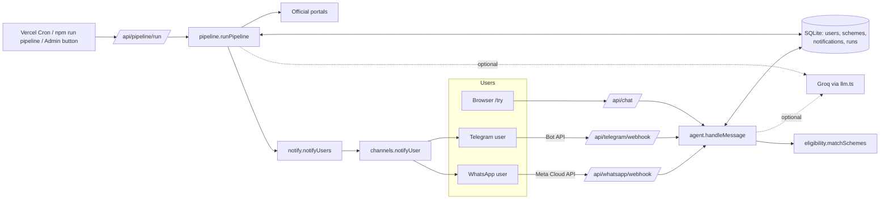
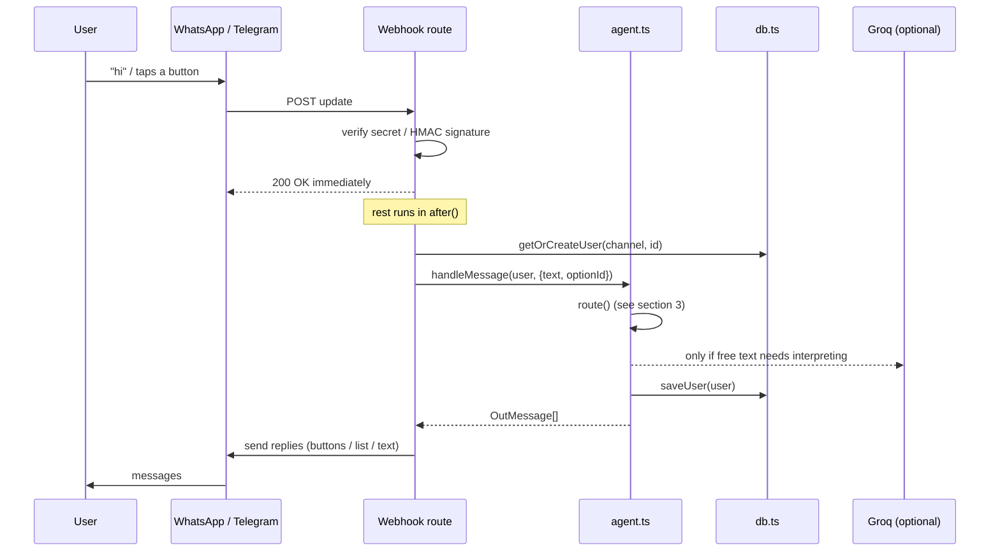
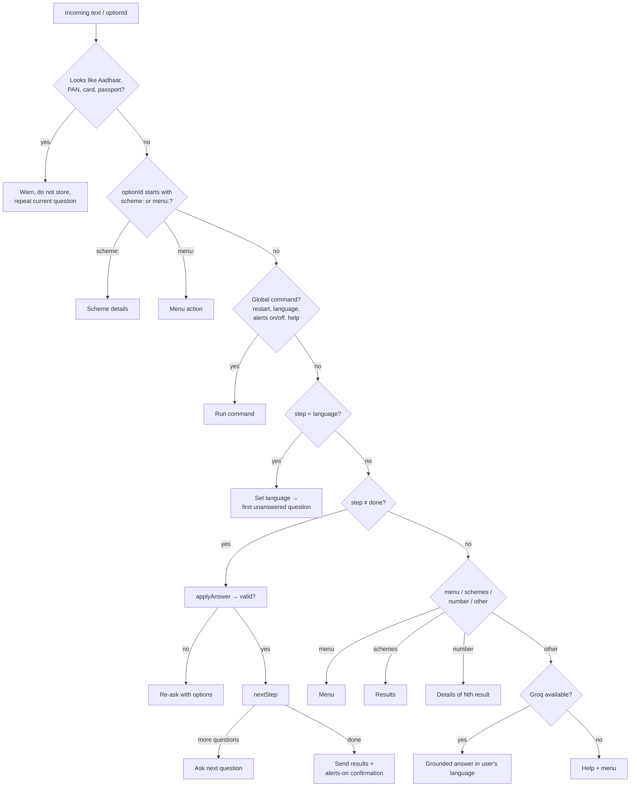
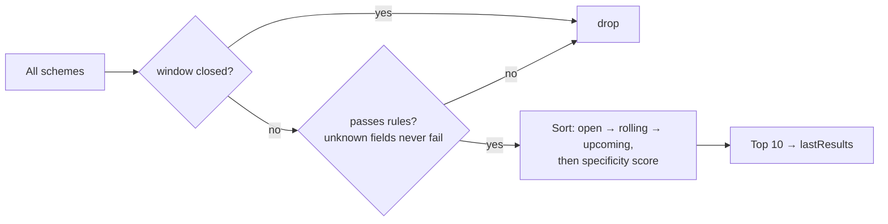
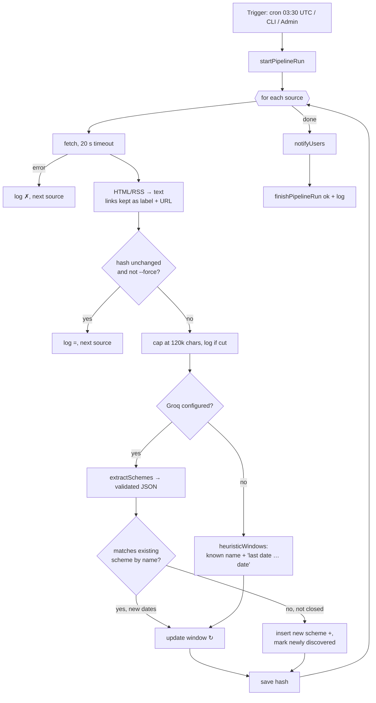
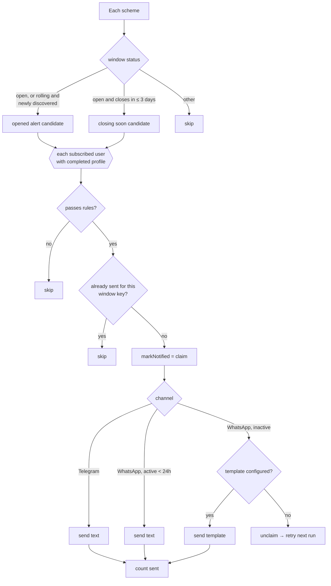
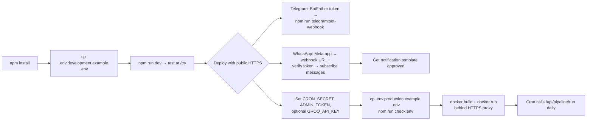
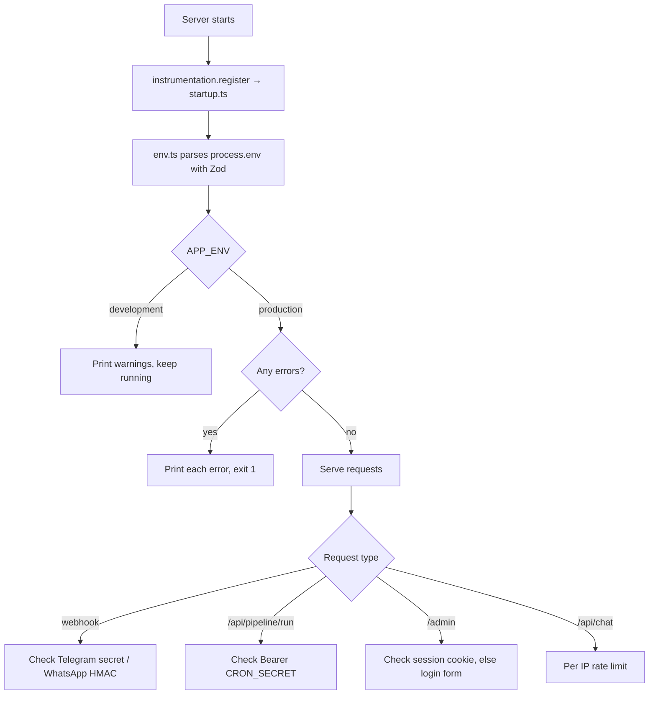
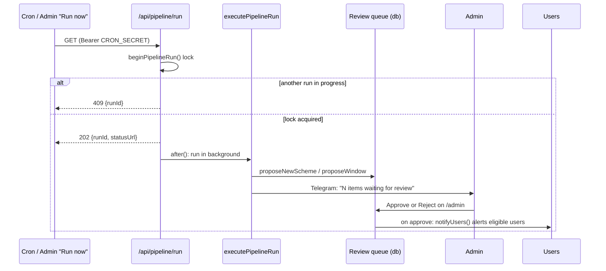
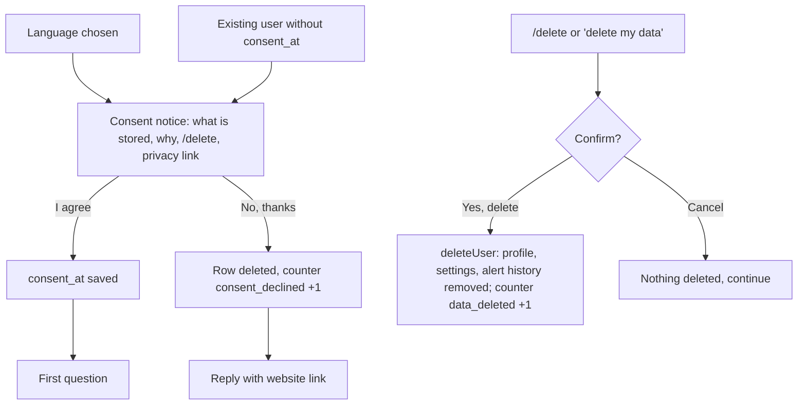

# Scheme Saathi: flows

How data and control move through the system at runtime. Diagrams are Mermaid (they render on GitHub and in most Markdown viewers). See [CODEBASE.md](CODEBASE.md) for file responsibilities.

---

## 1. System overview



---

## 2. Inbound message flow (all channels)



Channel specifics:

| Step | WhatsApp | Telegram | Web `/try` |
| --- | --- | --- | --- |
| Auth | `X-Hub-Signature-256` HMAC with app secret | `X-Telegram-Bot-Api-Secret-Token` header | Session id format check |
| Dedup | In-memory set of message ids (Meta retries) | Not needed | Not needed |
| Button taps | `interactive.button_reply` / `list_reply` id | `callback_query.data` | `optionId` in body |
| Options render | ≤3 reply buttons, else list (≤10 rows) | Inline keyboard, one per row | Stacked buttons |
| Response | After `200`, via Graph API | After `200`, via `sendMessage` | Inline JSON response |

---

## 3. Conversation state machine

```mermaid
stateDiagram-v2
  [*] --> language
  language --> consent: language chosen
  consent --> age: I agree
  consent --> [*]: No, thanks (nothing stored)
  age --> gender
  gender --> state
  state --> area
  area --> occupation
  occupation --> ownsLand: farmer
  occupation --> income: anything else
  ownsLand --> income
  income --> category
  category --> disability
  disability --> bpl
  bpl --> girlChild: age ≥ 18
  bpl --> done: age < 18
  girlChild --> done
  done --> done: menu / schemes / number / question
  done --> age: restart / "Update my details"
  done --> language: "language"
```

### Routing inside `route()` (every message)



### How an answer is understood (`resolveChoice`)

1. Tapped button id matches an option → use it.
2. Number `1..n` → nth option.
3. Option id or label in **any** language (case-insensitive) → that option.
4. Yes/no words: `yes, haan, हाँ, അതെ, ഉണ്ട്` / `no, nahi, नहीं, ഇല്ല`.
5. Groq `interpretChoice()` (returns only an offered id or null).
6. Otherwise "please choose" with the options again.

Age uses the first 1 to 3 digit number, then Groq. State uses the alias table, then Groq, then the alias table again on Groq's answer.

---

## 4. Eligibility and ranking



Specificity score (higher shows first): occupation +3, state +3, category +2, disability/girl child/land +2, gender +1, income +1, BPL +1, age +1.

---

## 5. Discovery pipeline



---

## 6. Alert flow



Window key = `opened:<openDate>..<closeDate>` (or `closing_soon:…`), so next year's round with new dates alerts again.

---

## 7. Website flows

| Page | Flow |
| --- | --- |
| `/` | Static at build. Hero content animates in; chat demo plays once in view (language tabs replay it); sections fade up via IntersectionObserver; tagline words light up one by one; scheme filters run client-side over data baked in from `seed.ts` |
| CTA buttons | `links.ts`: WhatsApp `wa.me/<number>?text=hi` and Telegram `t.me/<bot>?start=hi` if configured, otherwise `/try` |
| `/try` | Loads/creates a `localStorage` session id → sends hidden "hi" → renders replies; button taps send `optionId`; "New chat" creates a new session |
| `/admin` | Server-rendered on each request; token check; "Run now" is a server action calling `runPipeline()` then revalidating the page |

---

## 8. Setup flow (operator)



---

## 9. Startup and configuration flow



---

## 10. Pipeline trigger, review queue and approval



Nothing found by the pipeline is visible to users (`isLive()` is false) until it is approved. Rejected schemes and rejected windows are remembered, so the pipeline never proposes them again.

---

## 11. Consent and deletion


